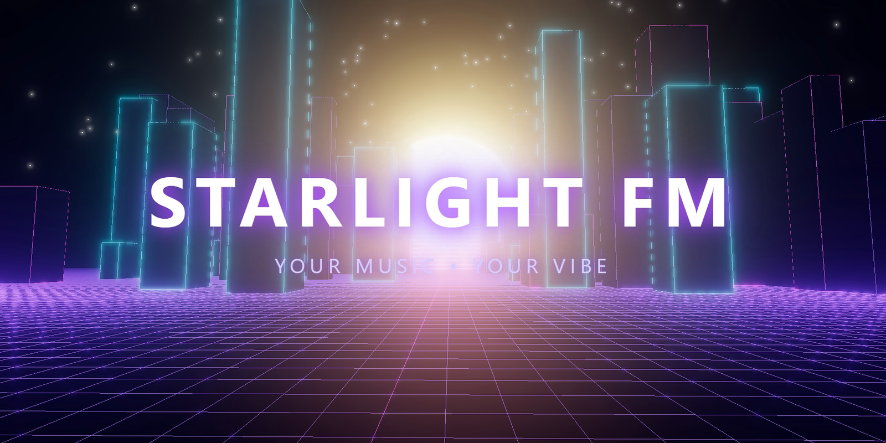
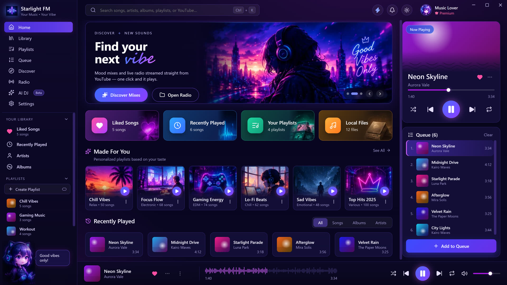
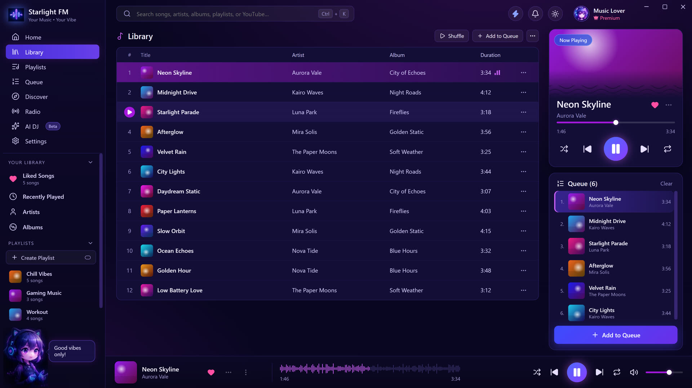
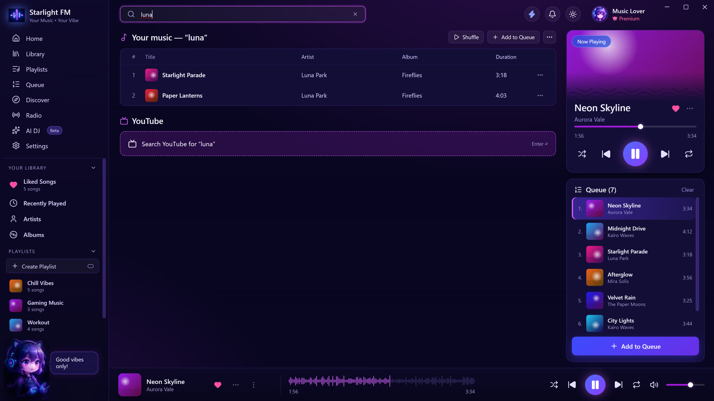
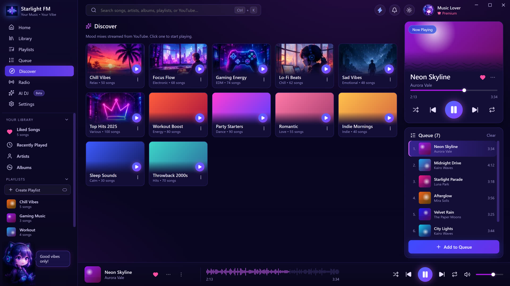
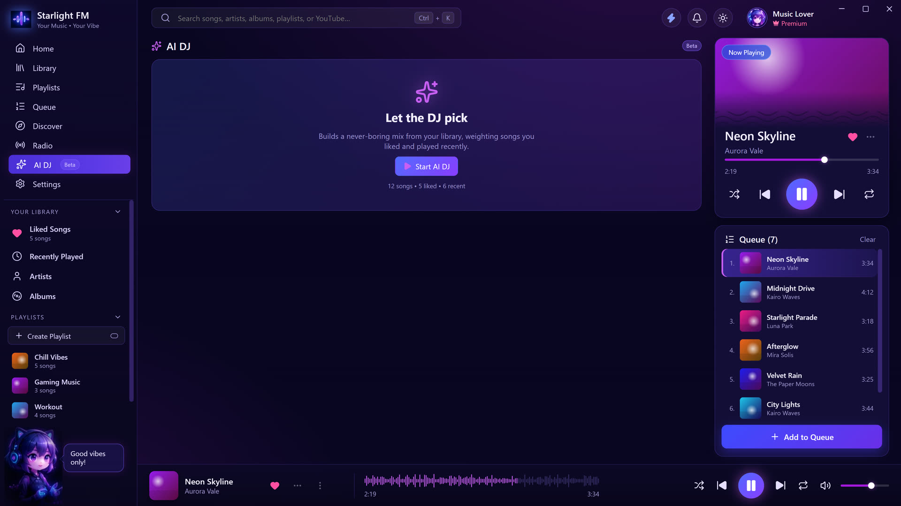
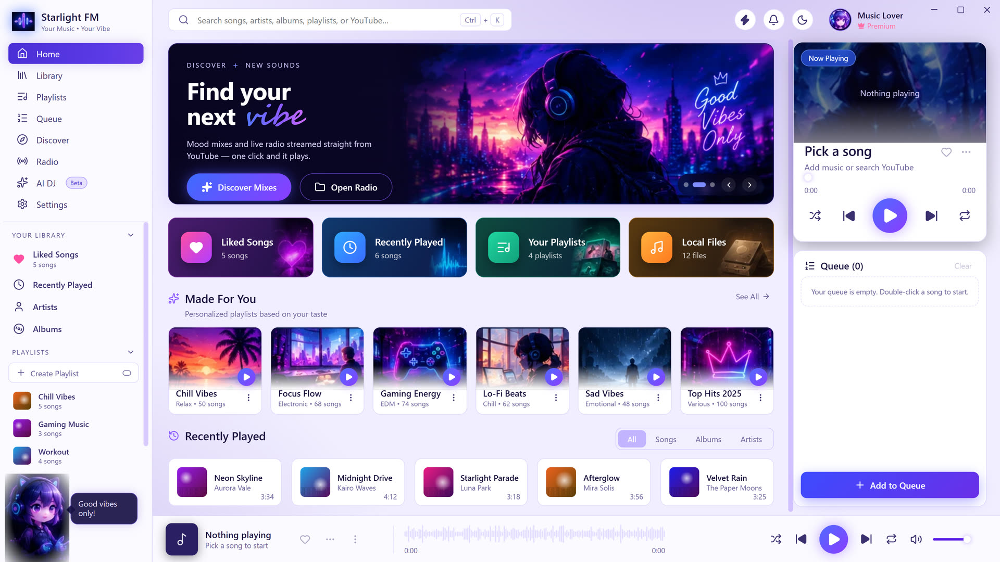
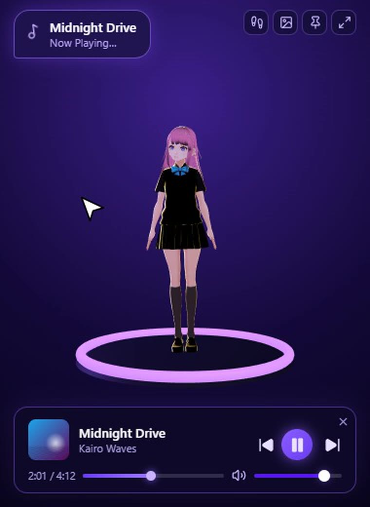
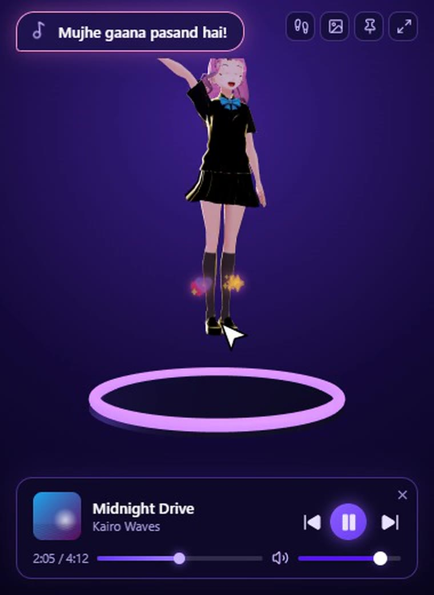

# Starlight FM

### Your music. Your vibe. With a companion.

A desktop music player for **Windows** and **macOS** - play your own library, search YouTube, read synced lyrics, let the AI&nbsp;DJ mix for you, and keep a floating **2D / 3D companion** on your desktop that dances to every beat.

  
  
  
  
  
  

[**Features**](#-features) &nbsp;&bull;&nbsp; [**Screenshots**](#-screenshots) &nbsp;&bull;&nbsp; [**Companion**](#-meet-the-companion) &nbsp;&bull;&nbsp; [**Download**](#-download--install) &nbsp;&bull;&nbsp; [**Build from source**](#-build-from-source) &nbsp;&bull;&nbsp; [**License**](#-copyright--license)

---

## Why Starlight FM?

Most players are either a plain file browser or a streaming website in a window. Starlight FM keeps **your own music first**, adds the good parts of streaming (YouTube, mood mixes, radio, lyrics), wraps it all in a polished neon interface - and gives your desktop a little personality.

- **No account, no sign-up, no tracking.** Your library and settings stay on your computer.
- **Fast.** Next YouTube songs are prepared in advance, so playback starts quickly.
- **Fun.** A companion character that follows your cursor, reacts when you poke it and bounces with the beat.

## Screenshots

<table>
  <tr>
    <td width="50%"> <b>Home</b> - hero banner, quick cards, mood mixes, now playing and queue</td>
    <td width="50%"> <b>Library</b> - every song with hover-play and a menu per track</td>
  </tr>
  <tr>
    <td> <b>Search</b> - your library first, YouTube in one Enter</td>
    <td> <b>Discover</b> - one-click mood mixes</td>
  </tr>
  <tr>
    <td> <b>AI DJ</b> - a mix built from what you like and play</td>
    <td> <b>Light theme</b> - one tap on the sun</td>
  </tr>
</table>

> Demo songs, artists and covers in the screenshots are fictional. A walkthrough video is available on the project website.

## Features

| | |
|---|---|
| **Local library** | MP3, WAV, FLAC, OGG, OPUS, M4A and AAC. Add files or folders, or drag & drop them in. Cover art and tags are read automatically. |
| **YouTube built in** | Search or paste a link and play it inside the app (via the optional [yt-dlp](https://github.com/yt-dlp/yt-dlp) helper). Stream links are cached and the next track is prefetched. |
| **Synced lyrics** | Line-by-line lyrics from [LRCLIB](https://lrclib.net) when available. |
| **Playlists, queue & likes** | Create playlists, like songs, see recently played, browse by artist or album. |
| **Discover & Radio** | Mood mixes (Chill, Focus, Gaming, Lo-Fi...) and live stations, one click away. |
| **AI DJ** | A local, weighted smart-shuffle that favours songs you like and play most. Nothing is sent to any AI service. |
| **Waveform player** | Waveform seek bar, big now-playing card, shuffle, repeat, media keys. |
| **Themes** | Dark and light, plus an accent colour that follows the current cover art. |
| **Keyboard friendly** | See [shortcuts](#keyboard-shortcuts). |
| **Compact companion mode** | Always-on-top mini player with a 2D or 3D character. |
| **Your own character** | Use your own PNG / GIF / WebP (2D) or `.vrm` / `.glb` (3D). |
| **Private by design** | No analytics, no accounts, no ads. |

## Meet the companion

Open compact mode (the lightning button, or click the mascot in the sidebar) and a small floating player appears with a character that lives on your desktop.

  
  &nbsp;&nbsp;
  

- **Follows your cursor** - head and eyes turn towards the mouse
- **Reacts when you poke it** - hops, waves, says something cute
- **Dances to the beat** - glows and bounces with the music
- **Scroll** to change volume, **double-click** to play/pause, **drag** it anywhere
- **Walk mode** - let it roam along your desktop
- **2D or 3D** - the 3D model supports blinking, expressions and spring-bone hair

## Download & install

Get the latest installers from the (Link) page.

| Platform | File | Notes |
|---|---|---|
| Windows 10 / 11 (64-bit) | `Starlight-FM-<version>-Windows-x64.exe` | Installer (choose folder, shortcuts) |

**First launch:** the builds are not code-signed yet.
- **Windows** - SmartScreen may say "Windows protected your PC": click **More info -> Run anyway**.

**YouTube support (optional):** open **Settings -> YouTube (yt-dlp) -> Install** once. It downloads the official yt-dlp build from GitHub. Use it for personal listening and respect YouTube's terms.

### Keyboard shortcuts

| Key | Action |
|---|---|
| `Space` | Play / pause |
| `Left` / `Right` | Seek -5 s / +5 s |
| `Shift` + `Left` / `Right` | Previous / next track |
| `Up` / `Down` | Volume up / down |
| `M` | Mute |
| `S` | Shuffle |
| `Ctrl` + `K`  or  `/` | Focus search |

## Tech stack

- **[Electron](https://www.electronjs.org/)** - desktop shell, custom frameless window, secure `media://` file protocol, IPC
- **[React 19](https://react.dev/) + [Vite](https://vitejs.dev/)** - interface
- **[three.js](https://threejs.org/) + [@pixiv/three-vrm](https://github.com/pixiv/three-vrm)** - 3D companion (VRM with expressions and spring bones)
- **Web Audio API** - playback and analysis
- **[music-metadata](https://github.com/Borewit/music-metadata)** - tags and cover art
- **[yt-dlp](https://github.com/yt-dlp/yt-dlp)** - optional YouTube helper (downloaded on demand)
- **[LRCLIB](https://lrclib.net)** - synced lyrics
- **[electron-builder](https://www.electron.build/)** - Windows (NSIS + portable) and macOS (DMG/ZIP) packaging

## Privacy

Starlight FM has **no accounts, no analytics and no tracking**. Your library, playlists, likes and settings are stored only on your computer. The app contacts the internet only when you use YouTube features, synced lyrics, or the one-time yt-dlp download.

## Credits & third-party components

Built with open-source software, each under its own licence - including Electron, React, Vite, three.js, @pixiv/three-vrm, lucide icons, music-metadata and yt-dlp. Lyrics data comes from LRCLIB. The bundled 3D character is a recoloured version of a free **CC0** VRoid sample model. Third-party components remain subject to their respective licences.

## Copyright & License

**This repository contains proprietary software developed by Ashborn.** The source code is publicly available for viewing on GitHub, but public visibility does not grant permission to reuse, modify, redistribute, or commercially exploit the code.

**Copyright &copy; 2026 Ashborn. All rights reserved.**

**No open-source license is granted for this project.**

- Viewing the repository does not grant reuse rights.
- Copying, modifying, redistributing, or commercially exploiting the code requires prior written permission from the copyright holder, except where permitted by applicable law.
- Third-party components remain subject to their respective licenses.

For permission or licensing inquiries, contact the copyright holder.

See [LICENSE](LICENSE) for the full notice.

## Disclaimer

This project is provided for informational and demonstration purposes. No warranty is provided, to the extent permitted by applicable law.

Starlight FM is not affiliated with, endorsed by or sponsored by YouTube or Google.

